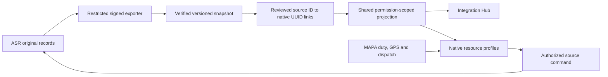

# ASR Health and MAPA Operations integration

Decision record: 5 October 2026. Planning review by three agents: original ASR source, native MAPA architecture, and operator workflow.

Status: proposed implementation architecture, based on source inspection. Not a deployment receipt. Live ASR screen comparison and dispatch-ownership confirmation are pending. The existing locally tested Integration Hub remains unchanged.

## Evidence and limits

- Original business logic inspected directly from `C:/Users/roysh/Downloads/ambulance.zip`. Archive entries are dated August/September 2026; this does not prove they equal the current production source.
- Current signed mirror: `../mobile/SourceSync.php`, `SourceInventoryController.php`, `SourceCommandController.php`, and this directory's `WRITEBACK.md`.
- Existing inventory import and provenance: `../import/ImportApply.php`, `SupplementApply.php`, and `../import/README.md`.
- Native assignments and details: `../../../fleetops-source/server/src/Models/Driver.php`, `Vehicle.php`, and native resource details under `../../../fleetops-source/addon/templates/management/` (paths from the workspace, not public assets).
- Enrollment and dispatch eligibility: `../mobile/EnrollmentService.php` and `../voice/AmbulanceDirectory.php`.
- Opening the source ambulance dashboard in the connected browser currently requires sign-in. No original-site mutations or live acceptance tests were performed for this review.

## Main decision

Keep the original ASR website's forms and behavior. Integrate through a restricted server-to-server contract, a reviewed identity mapping, and one shared source projection consumed by the Hub and native resource screens.

The Integration Hub is the place to manage connection health, fetches, unmatched identities and conflicts. Ambulances, Drivers, Hospitals & Bases, Maintenance and Analytics remain the places where operators use the data. They should not have to open the Hub to see the ASR details of an already linked record.

No browser database credentials, original-site login cookies, or server passwords form part of this connection. No browser scraping is the production sync mechanism.

## Ownership and placement

| Record or field | Primary system | Where it appears and how it changes |
| --- | --- | --- |
| Ambulance source ID, registration, category, model/year and administrative PHC | ASR | Native Ambulance list badge and profile ASR panel. Source-owned edit actions use signed ASR commands and verified readback. |
| Source administrative area, parking point and mapping coordinates | ASR | Source mapping section with provenance. These coordinates are never live vehicle GPS or automatically a verified patient/destination pin. |
| Driver source identity, joining date and administrative posting | ASR | Native Driver profile ASR panel, after reviewed source-ID mapping. Duplicate phone numbers never merge identities. |
| Native user, verified phone, role, crew approval and device binding | MAPA | Existing enrollment/account controls. Importing a driver roster grants no account access or duty. |
| PHC/facility source identity/type | ASR | Hospitals & Bases source panel and source-linked inventory counts. |
| Verified hospital address/pin, receiving staff and destination eligibility | MAPA | Existing hospital/base setup. A source PHC without verified coordinates is a review item, not a fabricated Place. |
| Attendance | ASR rule | Driver report labelled ASR attendance. Original rule is PHC/day-based and includes Off Road daily records; it is not individual app duty. |
| Road, daily-session and repair history | ASR | Ambulance history and a separate ASR history section in Maintenance. Do not manufacture native work orders/parts consumption. |
| Source allocations | ASR historical trip records | Historical participation only. Never assign the current native driver from these rows. |
| Source trip statistics | ASR report semantics | Separate historical report totals with clear units. No automatic addition to MAPA journey totals. |
| Current native assignment, GPS, duty, acknowledgement, caller pickup and live trip | MAPA | Existing Operations/crew/caller/hospital workflows and permissions. Source fetches cannot overwrite these. |

## Original behavior that changes the design

1. The original ambulance form includes mandal, secretariat, coordinates, parking and category-specific validation. The current exporter omits some of these fields. Extend the contract explicitly before promising equivalent profile coverage.
2. Original ambulance transfer changes PHC and institute type only. Existing administrative coordinates/parking/area can remain unchanged. Preserve that behavior and flag any mismatch for review; do not silently relocate a vehicle or hospital.
3. Original repair history includes status, cost, repair place and items; the current export lacks those details. In particular, current source road status depends on repair completion as well as daily status. A list of historical statuses alone is insufficient for an availability decision.
4. Original daily sessions include closed state and closing odometer. Source available-ambulance selection checks today's On Road session, an open session, and no open trip. Current snapshot lacks enough state to reproduce that rule.
5. The archive contains a separate original CAD dispatch lifecycle backed by `cad_incidents`, `cad_dispatch_log`, `cad_status_updates` and `amb_trips`. The current integration has no cross-system incident/trip identity or ownership contract. Confirm whether that CAD is in operational use before connecting dispatch state.
6. One source journey can create several patient trip rows while updating session odometer once. The archived insertion code stores actual distance on the first patient row and zero on additional patient rows, protecting SUM(distance_kms) against multi-patient mileage duplication. COUNT(*) still counts patient/trip rows rather than distinct ambulance journeys. Keep source report units explicit and do not add these totals to MAPA totals without journey-level reconciliation.
7. The archived manual running workflow opens a daily session, then submits a trip form containing both pickup and drop date/time. It does not persist a separate Start Trip event in that flow. The current website may differ; verify the driver's live screen before choosing a matching mobile start/save/end contract. MAPA's live trip-start events remain distinct from completed source record entry until the bridge is defined.

Archive evidence for those rules:

| Archive PHP file | Relevant code lines and finding |
| --- | --- |
| `ambulance_index.php` | 45–100: unique registration; 108 requires mandal; Feeder/Bike requires institute, PHC and secretariat; other categories require institute and PHC. 130–151: PHC/institute-only transfer. |
| `ambulance_profile.php` | 156–164: model/year edit; 175–200: report aggregation; 253–295: historical PHC/allocation blocks. |
| `drivers.php` | 5–30 and 72–135: module permissions, coordinator category restriction and PHC-only transfer; 166–194: role/PHC selectors. |
| `driver_attendance_report.php` | 90–136: PHC/day attendance; future and pre-joining days excluded. |
| `ambulance_running.php` | 10–23: GET itself closes older On Road sessions at PHP-time 03:00; 171–203: ambulance/day uniqueness and off-road lock; 345–364: patient-row creation vs single journey odometer change; 371–455: session/odometer changes. Do not open this page as a supposedly read-only integration probe. |
| `off_road_ambulances.php` | 53–67: latest Off Road or non-Completed repair; 115–240: repair details and completion's compound daily-status change. |
| `cad_get_available_ambulances.php` | 20–31: today's On Road, open session and no active trip. |
| `cad_save_dispatch.php` | 49–70 and 84–134: active-trip collision checks and linked incident/dispatch/trip writes. |
| `cad_update_status.php` | 45–118: dispatch transitions and cancellation's source trip deletion. |
| `cad_complete_trip.php` | 85–113: trip, odometer, incident, dispatch and timeline completion. |

The archive's role filters and business commands need production-version verification. Do not reproduce a compound source action as a single direct field update.

## Identity and review design

- Durable unique identity: `(company, source origin, entity type, source ID) -> native UUID`.
- Existing `meta.asr_import` registration/base/provenance keys produce candidates. They do not authorize an automatic link. The old CSV keys and current database IDs must be reconciled explicitly.
- Review shows both source and native identity, category/base, existing assignment, source generation/hash and any collision. Hospital candidates must be permitted hospital/base types. Driver candidates require a valid active User relationship.
- Separate integration capabilities: read scoped source projections, review links, provision inventory, and submit source edits. Existing crew-review permission alone must not implicitly grant every integration action.
- Candidate search is bounded and paginated; reviewers can search driver names and public IDs with appropriate access. Match by source ID, never phone/name alone.
- Persist link revision, source fingerprint/generation, reviewer, reason, previous mapping and timestamps in a durable audit trail. Define explicit reviewed unlink/relink operations.
- Source removal creates a tombstone/review item. Never delete native accounts, vehicles, assignments or trip history automatically.
- Missing vehicles/hospitals use a reviewed inventory-creation path based on the existing importer. Preserve all collision checks, offline/unknown vehicle position, verified facility-coordinate requirements and existing native records. Driver activation uses enrollment.
- Latest source-change observations are not a durable review queue. Implement separate acknowledged reconciliation items rather than repurposing the capped latest-500 change list.

## Backend contract and synchronization

1. Add a versioned source contract for the additional approved profile/session/repair fields; validate exact schemas, source timezone, query load and maximum sizes against production before activation.
2. Receive complete signed snapshots atomically. Maintain generation, received time and provenance; stale or failed fetches retain the last verified generation.
3. Build a batch projection service keyed by reviewed native UUIDs. The Hub and native profile panels use the same generation. Restrict returned fields to the caller's role; crew/caller/hospital views do not receive the full staff directory.
4. On a successful fetch, invalidate visible source projections using a metadata-only event; re-fetch on focus and a bounded timer. Preserve unsaved native forms and active map/trip state. Credentials and record contents are not cross-tab messages.
5. Schedule source reception independently on the VPS after measuring load. A browser refresh timer only re-reads the snapshot and cannot by itself keep the source synchronized. Proposed 30-second server plus 30-second visible client intervals mean roughly 60-second updates, not instantaneous updates.
6. ASR-owned writes flow through existing action-specific source commands. Check current source permissions, expected revision and an idempotency key; commit once and refresh from ASR. Do not dual-write ASR and native operational columns.
7. Successful source save followed by refresh failure is shown as saved at ASR / awaiting refresh. A conflict shows current and proposed values for review. Unknown outcomes retry the same request rather than issuing a new mutation.
8. Active MAPA trips stay under MAPA ownership. If original CAD is also used, introduce shared incident/journey IDs, per-trip owner, cross-system reservation/conflict checks and explicit lifecycle handoff before any dispatch exchange. This is a separate design gate.

## Frontend placement

- Keep the approved Maintenance Hub-style Integration page inside the native shell.
- Add actual source/native/unlinked/conflict counts; use unknown/pending rather than invented zeroes.
- Extend existing `Vehicle::Details`, `Driver::Details` and Place details with a reusable ASR record panel and clear freshness/removed/conflict badges.
- Use typed profile sections rather than raw object-key tables: overview, administrative base, history, repairs, attendance and source totals as applicable.
- Preserve original service categories (104, 108, Feeder/Bike, Special, Thalli Bidda Express) and original permission/category restrictions where applicable.
- Show source-owned edit/transfer controls only for permitted actions. Native assignment controls remain separate and use existing protections.
- Label native dispatch availability independently from source On Road history and source inventory membership.

## Delivery and acceptance

Implement locally in this order:

1. Verify the current source screens/schema and freeze the expanded field contract and capability matrix.
2. Build reviewed mapping, reconciliation queue and complete audit; test the isolated database implementation.
3. Add the shared projection and native resource panels; wire snapshot-generation refresh and test without reloading native drafts.
4. Add reviewed missing-inventory provisioning and registration-to-source matching through existing workflows.
5. Test the three existing narrow source write actions through the native panels, then consider additional original workflows separately.
6. Deploy read projection first after commissioning; enable reviewed links and restricted write actions only after their acceptance checks. Preserve the original website's functions throughout.

Required tests: duplicate/shared-phone identities; cross-company and role boundaries; revoked sessions; simulated/deleted/wrong-type candidates; concurrent linking/relink conflicts; repeat fetch without duplicate resources; stale/out-of-order snapshots; source removal without native deletion; source transfer during active dispatch; exactly-once command retry; refresh failure after save; no double-counted totals; no fake GPS/duty; native drafts preserved; original ASR workflow regression.

## Current implementation boundary

Existing local Hub/mirror/narrow write-back tests remain recorded in `verification.json`. Those tests do not cover this new architecture or establish production sync.

An initial connection-controller/migration sketch was created before the planning review. It is isolated under `planning/*.php.draft`, has no registered routes, and is not an active migration. It is untested and must be revised for the requirements above. The existing controller and service provider were restored to their previously verified file hashes.

No production deployment, source operational change, account change, dispatch or message was performed by this architecture review.
